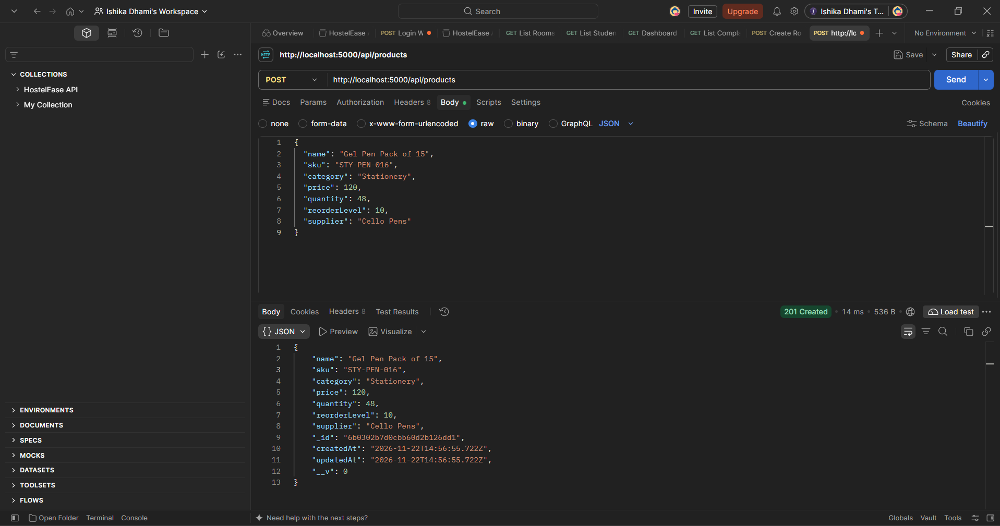
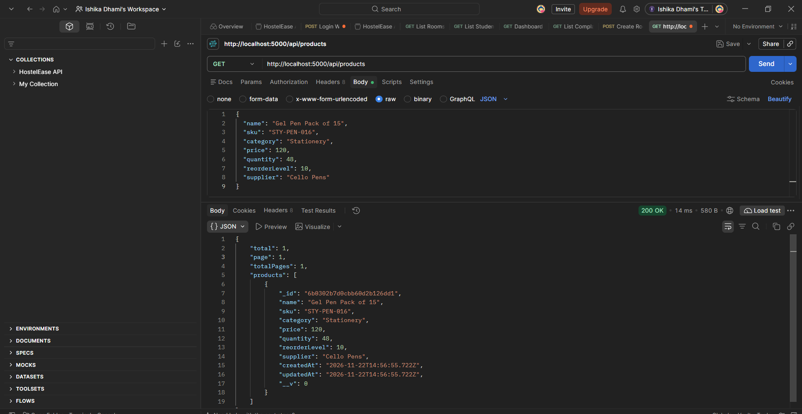
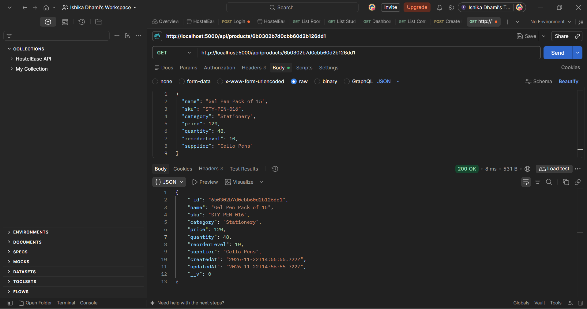
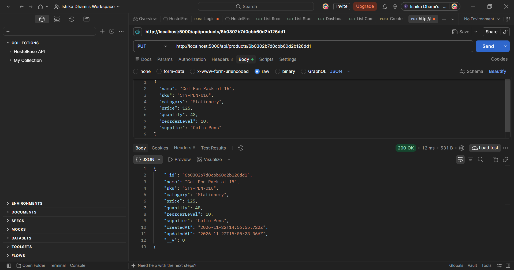
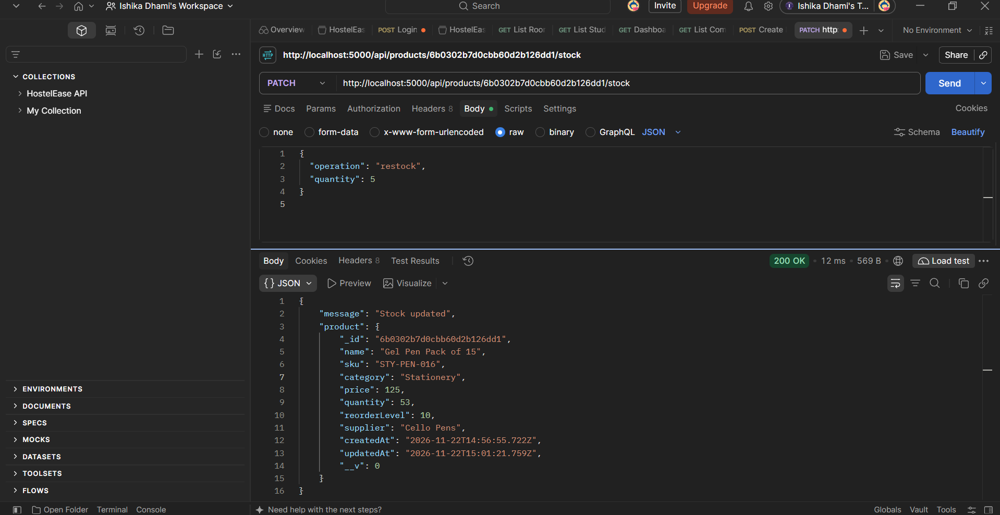
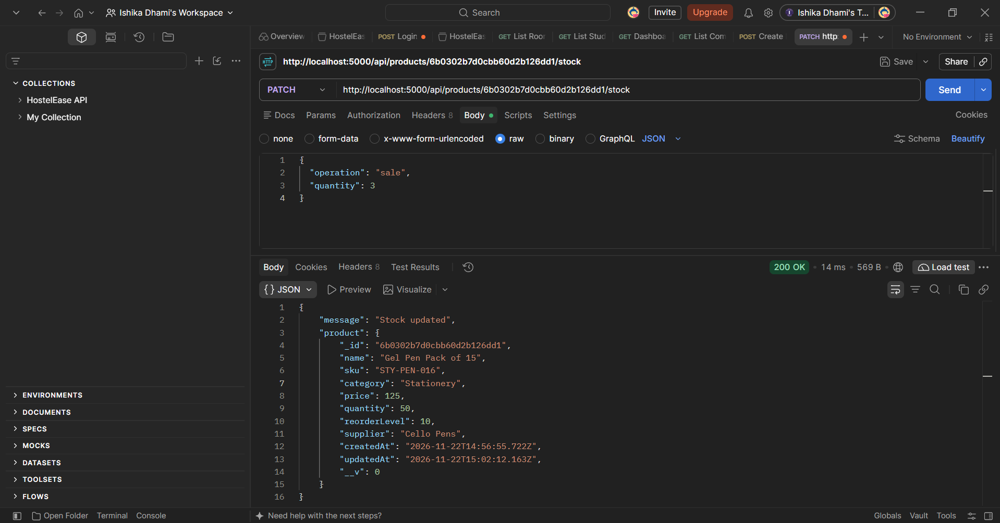
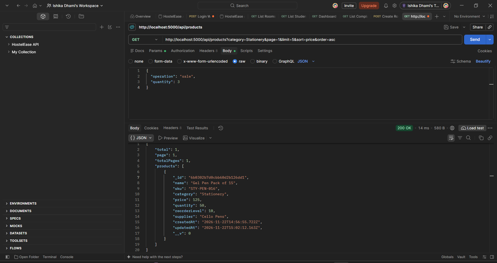
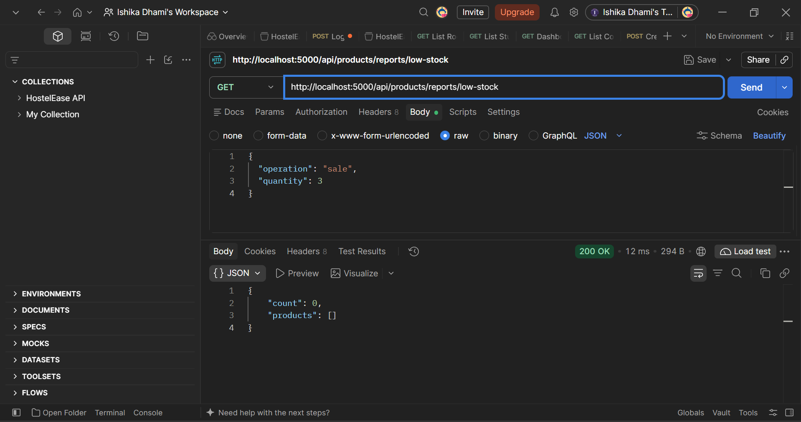
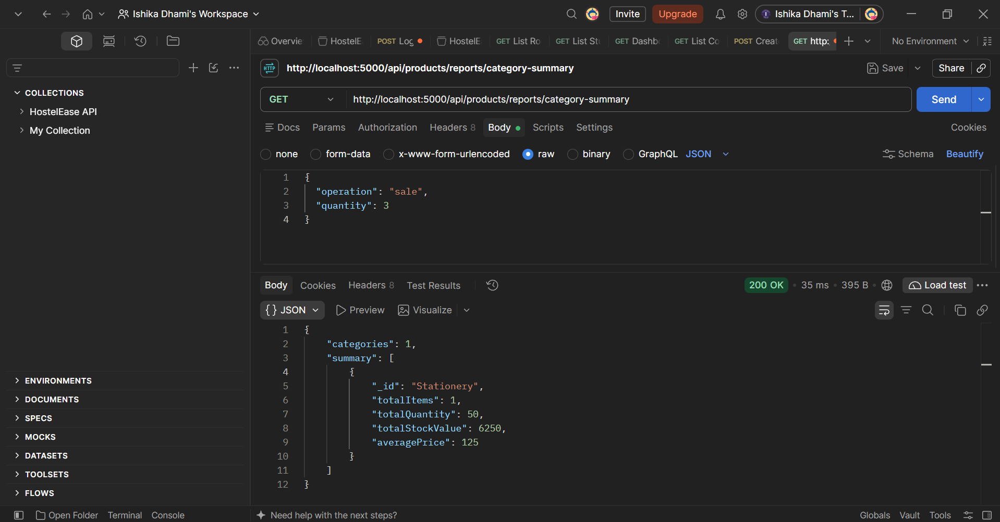
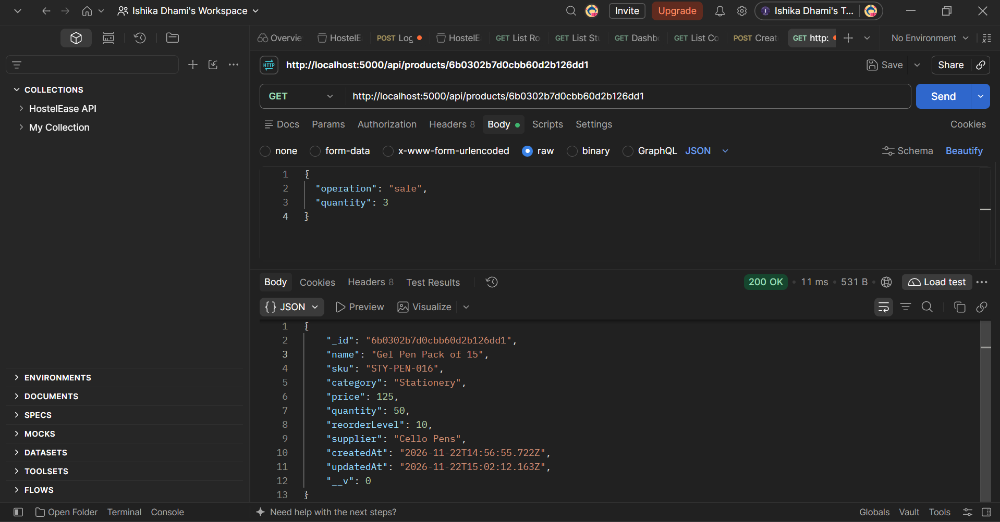

# Inventory and Data Management System

A REST API for managing inventory products. Built with Node.js, Express.js, MongoDB, and Mongoose.

## Features

- Create, view, update, and delete products
- Search and filter products
- Sort and paginate product results
- Adjust stock for restocking and sales
- View low-stock products
- View inventory summaries by category
- Validate product data

## Requirements

- Node.js and npm
- MongoDB running locally

## Setup

1. Install the project packages:

   ```bash
   npm install
      ```

2. Project root mein `.env` file banao:

   ```env
   PORT=5000
   MONGO_URI=mongodb://127.0.0.1:27017/inventory_db
   ```

3. Server start karo:

   ```bash
   npm run dev
   ```

API `http://localhost:5000` par chalegi.

## API Endpoints

| Method | Endpoint | Kaam |
|---|---|---|
| GET | `/` | API running check |
| POST | `/api/products` | Product banana |
| GET | `/api/products` | Products dekhna; filter, sort, pagination |
| GET | `/api/products/:id` | ID se product dekhna |
| PUT | `/api/products/:id` | Product update karna |
| PATCH | `/api/products/:id/stock` | Restock ya sale record karna |
| DELETE | `/api/products/:id` | Product delete karna |
| GET | `/api/products/reports/low-stock` | Low-stock report |
| GET | `/api/products/reports/category-summary` | Category summary |

### Filter example

`GET /api/products?category=Stationery&page=1&limit=5&sort=price&order=asc`

## Postman Screenshots

### Create product


### Get all products


### Get product by ID


### Update product


### Restock


### Record a sale


### Filter, sort, and pagination


### Low-stock report


### Category summary


### Delete product
